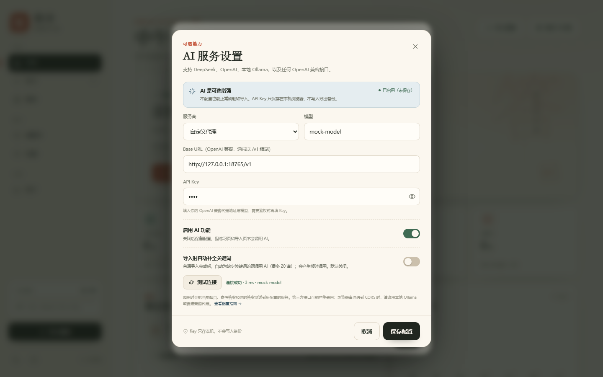
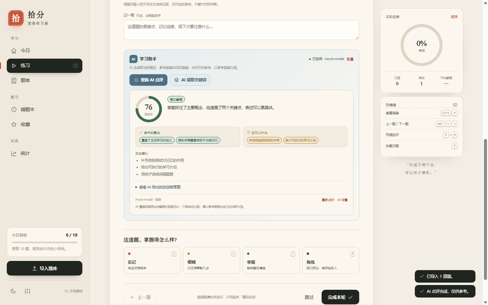
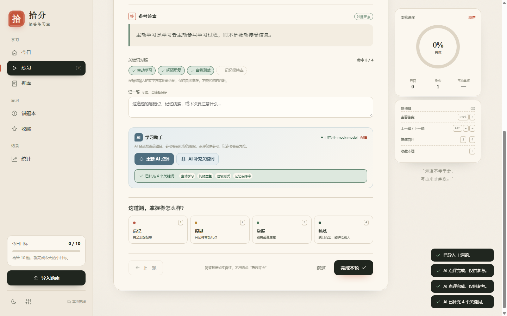
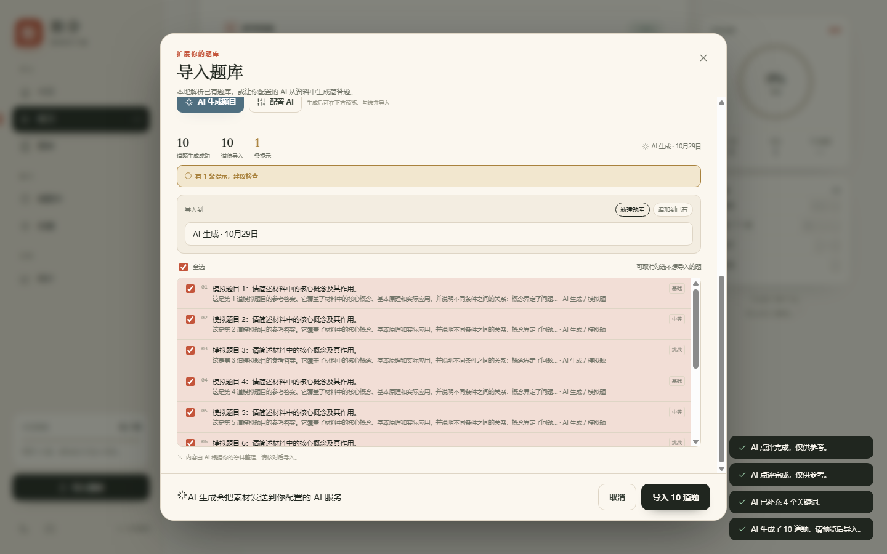
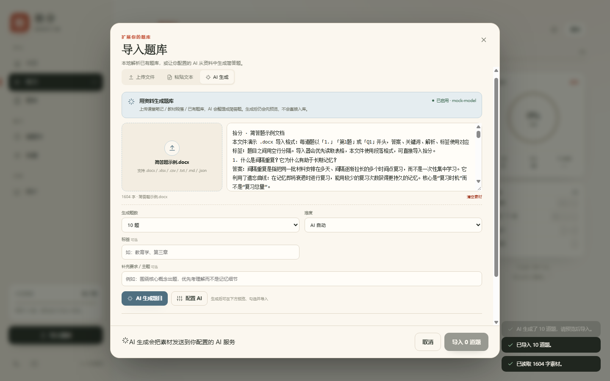
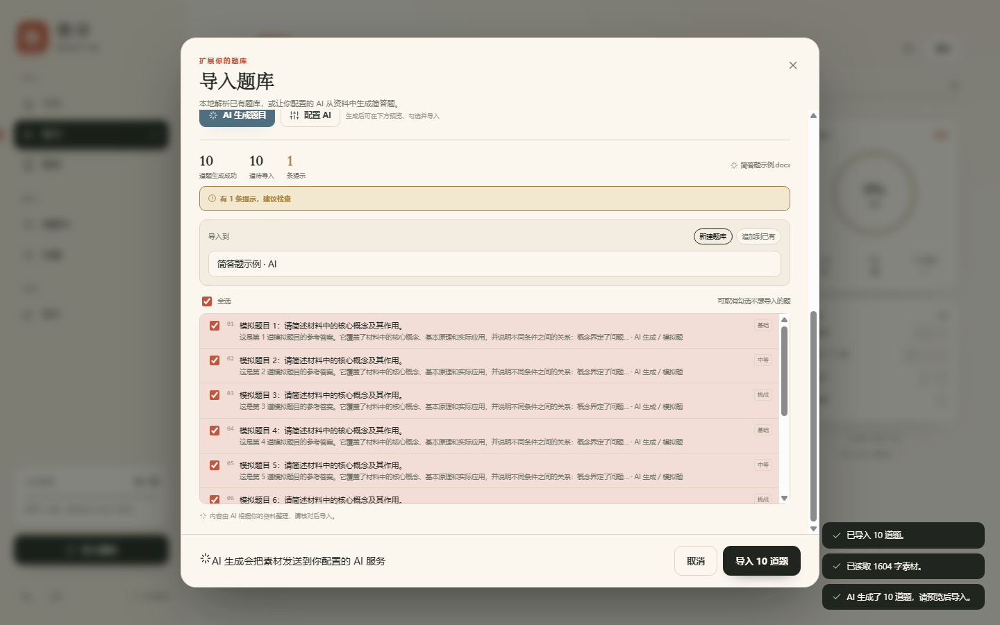
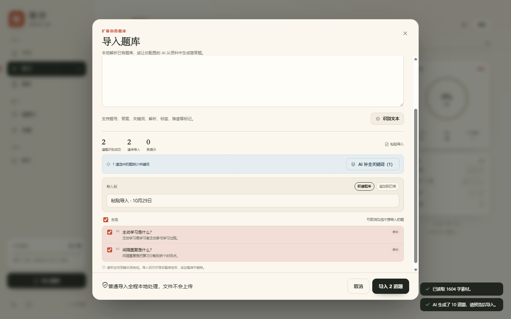
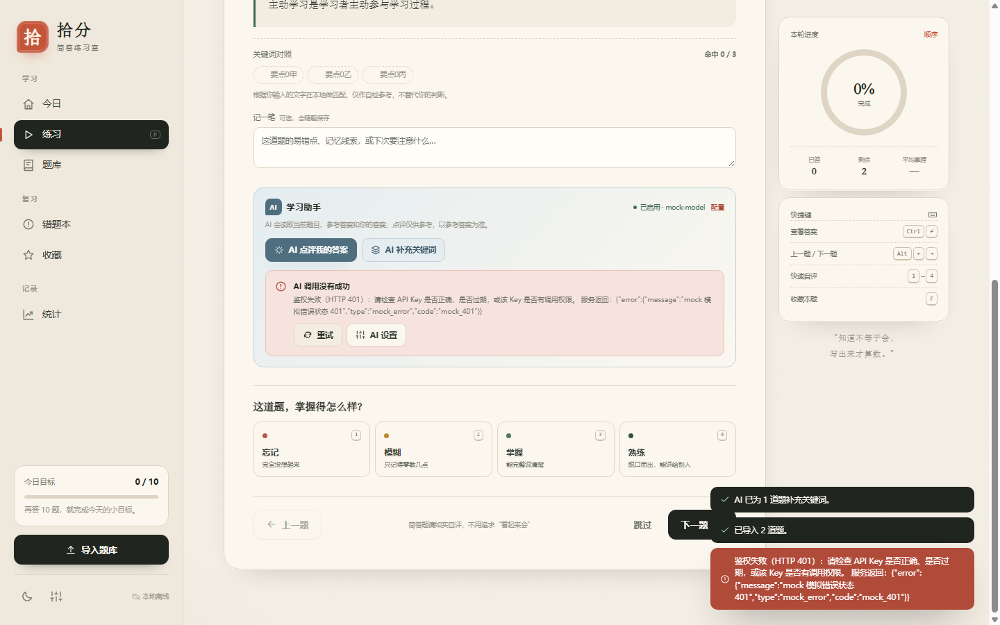
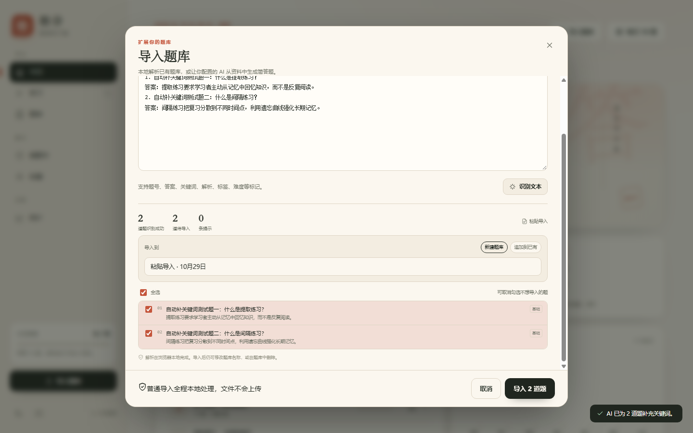

# 拾分 · AI 功能 E2E 验收报告

- 生成时间：2026/10/29 12:33:49
- 运行耗时：43 秒
- 应用：http://127.0.0.1:8765/index.html
- 静态服务：复用已有 8765
- Mock AI：http://127.0.0.1:18765（PING 已校验）
- 浏览器：Chrome/154.0.8037.98（共享 CDP http://127.0.0.1:9222，仅操作自己的 target）
- 视口：1440x900

## 应用文件

- index.html: 19043 bytes
- js/app.js: 176021 bytes
- js/ai.js: 35491 bytes
- js/importers.js: 63870 bytes
- tests/mock-ai-server.mjs: 14634 bytes

## 结果汇总

| 通过 | 失败 | 跳过 | 合计 |
| --- | --- | --- | --- |
| 9 | 0 | 0 | 9 |

**结论：9/9 项通过，0 项失败，AI 功能验收通过。**

## 逐项结果

| 编号 | 验收项 | 结果 | 证据摘要 | 截图 |
| --- | --- | --- | --- | --- |
| A1 | AI 设置：custom + mock 端点 + 测试连接 + 保存 | PASS | 测试连接：连接成功 · 3 ms · mock-model；保存后 settings.ai={"enabled":true,"provider":"custom","baseUrl":"http://127.0.0.1:18765/v1","model":"mock-model","apiKey":"***","temperature":0.3,"autoKeywords":f… | [图](screenshots-ai/01-ai-settings-1440.png) |
| A2 | 练习：AI 点评（score 76 / 命中 / 遗漏 / 建议）+ 提取关键词 | PASS | 练习素材：什么是主动学习？（bank=粘贴导入 · 10月29日）；点评文本：76 覆盖率 基本掌握 答案抓住了主要概念，但遗漏了两个关键点，表述可以更具体。 命中的要点 覆盖了主动学习的定义 提到间隔重复有助于长期记忆 还可以补充 未说明自我测试的作用 缺少可执行的学习计划 改进建议 补充自我测试对记忆的作用 给出可执行的学习计划 用例子说明间隔重复 看看 AI 给出的改进版… | [图](screenshots-ai/02-ai-review-1440.png) [图](screenshots-ai/03-ai-keywords-1440.png) |
| A3 | AI 导入：粘贴材料 → 生成 10 题 → 预览 → 导入 → 可练习 | PASS | 生成预览：10 道题生成成功 10 道待导入 1 条提示 AI 生成 · 10月29日 有 1 条提示，建议检查 导入到 新建题库 追加到已有 全选 可取消勾选不想导入的题 01 模拟题目 1：请简述材料中的核心概念及其作用。 这是第 1 道模拟题目的参考答案。它覆盖了材料中的核心概念、基本原理和实际应用，并说明不同条件之间的关系：概念界定了问题… · AI 生成 / 模拟题 … | [图](screenshots-ai/04-ai-import-preview-1440.png) |
| A4 | AI 导入：docx 素材提取 1604 字并生成 | PASS | docx 提取字数：1604；1604 字 · 简答题示例.docx；docx 素材生成 10 题预览正常 | [图](screenshots-ai/05-ai-docx-source-1440.png) [图](screenshots-ai/06-ai-docx-generate-1440.png) |
| A5 | 导入预览：AI 补全关键词，且不覆盖已有关键词 | PASS | AI 补全条：1 道选中的题缺少关键词 AI 补全关键词（1）；补全题关键词：要点0甲、要点0乙、要点0丙；原有：间隔、复习 | [图](screenshots-ai/07-ai-preview-keywords-1440.png) |
| A6 | 错误处理：mock 401 可读提示、页面不崩、不写 aiReviews | PASS | 错误卡片：AI 调用没有成功 鉴权失败（HTTP 401）：请检查 API Key 是否正确、是否过期，或该 Key 是否有调用权限。 服务返回：{"error":{"message":"mock 模拟错误状态 401","type":"mock_error","code":"mock_401"}} 重试 AI 设置；解除 401 后重试成功，已写入 aiReviews | [图](screenshots-ai/08-ai-401-error-1440.png) |
| A7 | 导出 JSON 不含 apiKey；本机 key 不丢 | PASS | 导出 AI 配置：{"enabled":true,"provider":"custom","baseUrl":"http://127.0.0.1:18765/v1","model":"mock-model","apiKey":"<redacted>","temperature":0.3,"autoKeywords":false}；导出后本机 apiKey 仍保留 | — |
| A9 | 设置开关：导入时自动补全关键词（默认关闭） | PASS | 默认关闭：aria-checked=false；已开启 settings.ai.autoKeywords=true；自动补全完成后预览已无缺关键词提示；自动补全入库关键词：要点0甲、要点0乙、要点0丙 \| 要点1甲、要点1乙、要点1丙；设置保持开启 | [图](screenshots-ai/09-ai-auto-keywords-1440.png) |
| A8 | 回归：原 tests/e2e.mjs 14 项全过 | PASS | 回归退出码=0，耗时 22s，报告汇总=14/0/0/14 项；原 E2E 14 项 PASS=14 FAIL=0（依据 tests/report.md） | — |

## 用例明细

### A1 AI 设置：custom + mock 端点 + 测试连接 + 保存 — PASS

- 验收标准：自定义服务商 baseUrl=http://127.0.0.1:18765/v1、model=mock-model、key=test；测试连接成功；保存后 settings.ai 正确
- 步骤：
  1. 设置 → AI 服务 → 配置 AI
  2. 选择 custom，填 Base URL / 模型 / Key，启用 AI
  3. 点击测试连接，等待“连接成功”
  4. 保存并检查 localStorage settings.ai
  5. 截图（AI 设置面板滚入视口）
- 证据：
  - 测试连接：连接成功 · 3 ms · mock-model
  - 保存后 settings.ai={"enabled":true,"provider":"custom","baseUrl":"http://127.0.0.1:18765/v1","model":"mock-model","apiKey":"***","temperature":0.3,"autoKeywords":false}
- 截图：[screenshots-ai/01-ai-settings-1440.png](screenshots-ai/01-ai-settings-1440.png)
- 耗时：2040 ms

### A2 练习：AI 点评（score 76 / 命中 / 遗漏 / 建议）+ 提取关键词 — PASS

- 验收标准：无关键词题：AI 点评显示 76 分、2 个命中、2 个遗漏、3 条建议并写入 aiReviews；AI 提取 4 个关键词并写入 localStorage
- 步骤：
  1. 导入一道无关键词题并进入练习
  2. 输入答案并 reveal
  3. 点击 AI 点评，校验分数/要点/建议/缓存
  4. 点击重新点评，缓存时间更新
  5. 点击 AI 提取关键词，校验 chips 与 localStorage 4 项
  6. 截图（AI 点评/关键词面板滚入视口）
- 证据：
  - 练习素材：什么是主动学习？（bank=粘贴导入 · 10月29日）
  - 点评文本：76 覆盖率 基本掌握 答案抓住了主要概念，但遗漏了两个关键点，表述可以更具体。 命中的要点 覆盖了主动学习的定义 提到间隔重复有助于长期记忆 还可以补充 未说明自我测试的作用 缺少可执行的学习计划 改进建议 补充自我测试对记忆的作用 给出可执行的学习计划 用例子说明间隔重复 看看 AI 给出的改进版答案 mock-model · 刚刚 重新点评 AI 设置 AI 覆盖率是表达完整度的粗略估计，不是考试分数；请以参考答案和自己的判断为准。
  - aiReviews[q_mvt1sh1i_4xw3i] score=76 verdict=基本掌握 at=1793248391832
  - 重新点评已更新 aiReviews.at
  - AI 关键词：主动学习、间隔重复、自我测试、记忆保持率
- 截图：[screenshots-ai/02-ai-review-1440.png](screenshots-ai/02-ai-review-1440.png)、[screenshots-ai/03-ai-keywords-1440.png](screenshots-ai/03-ai-keywords-1440.png)
- 耗时：3914 ms

### A3 AI 导入：粘贴材料 → 生成 10 题 → 预览 → 导入 → 可练习 — PASS

- 验收标准：粘贴素材后生成 10 道题，预览显示 10 道题生成成功，确认导入后新题库出现且可进入练习
- 步骤：
  1. 打开导入弹窗 → AI 生成 tab
  2. 粘贴材料，生成题数选 10
  3. 点击 AI 生成题目，等待预览 10 题
  4. 确认导入，校验题库/题目数量
  5. 从新题库进入练习
  6. 截图（预览面板滚入视口）
- 证据：
  - 生成预览：10 道题生成成功 10 道待导入 1 条提示 AI 生成 · 10月29日 有 1 条提示，建议检查 导入到 新建题库 追加到已有 全选 可取消勾选不想导入的题 01 模拟题目 1：请简述材料中的核心概念及其作用。 这是第 1 道模拟题目的参考答案。它覆盖了材料中的核心概念、基本原理和实际应用，并说明不同条件之间的关系：概念界定了问题… · AI 生成 / 模拟题 基础 02 模拟题目 2：请简述材料中的核心概念及其作用。 这是第 2 道模拟题目的参考答案。它覆盖了材料中的核心概念、基本原理和实际应用，并说明不同…
  - 导入 AI 题库：AI 生成 · 10月29日（10 题）
  - AI 题库已可练习：模拟题目 1：请简述材料中的核心概念及其作用。
- 截图：[screenshots-ai/04-ai-import-preview-1440.png](screenshots-ai/04-ai-import-preview-1440.png)
- 耗时：2631 ms

### A4 AI 导入：docx 素材提取 1604 字并生成 — PASS

- 验收标准：samples/简答题示例.docx 经 extractText 提取 1604 字，AI 可据此生成 10 题预览
- 步骤：
  1. 打开导入弹窗 → AI 生成 tab
  2. 选择 samples/简答题示例.docx
  3. 校验提取字数 = 1604
  4. 生成 10 题并校验预览
  5. 截图（素材/预览面板滚入视口）
- 证据：
  - docx 提取字数：1604；1604 字 · 简答题示例.docx
  - docx 素材生成 10 题预览正常
- 截图：[screenshots-ai/05-ai-docx-source-1440.png](screenshots-ai/05-ai-docx-source-1440.png)、[screenshots-ai/06-ai-docx-generate-1440.png](screenshots-ai/06-ai-docx-generate-1440.png)
- 耗时：1928 ms

### A5 导入预览：AI 补全关键词，且不覆盖已有关键词 — PASS

- 验收标准：粘贴两题（一题无关键词、一题有关键词）→ 预览出现“AI 补全关键词（1）” → 补全后导入：缺关键词题写入 3 个，已有关键词保持“间隔、复习”不变
- 步骤：
  1. 粘贴 CSV 两题（缺/有关键词各一）
  2. 预览出现 AI 补全关键词按钮并截图
  3. 点击补全，等待命中数清零
  4. 确认导入，校验两题关键词
  5. 截图（预览 AI 条滚入视口）
- 证据：
  - AI 补全条：1 道选中的题缺少关键词 AI 补全关键词（1）
  - 补全题关键词：要点0甲、要点0乙、要点0丙；原有：间隔、复习
- 截图：[screenshots-ai/07-ai-preview-keywords-1440.png](screenshots-ai/07-ai-preview-keywords-1440.png)
- 耗时：1725 ms

### A6 错误处理：mock 401 可读提示、页面不崩、不写 aiReviews — PASS

- 验收标准：AI 点评返回 401 时显示可读“鉴权失败”错误卡片，aiReviews 不新增；解除错误后重试成功并写入缓存
- 步骤：
  1. 进入 AI 题库某题，输入答案并 reveal
  2. 记录 aiReviews 数量与当前 qid
  3. 开启测试侧 401 注入，点击 AI 点评
  4. 校验错误卡片文案、缓存未写、页面未崩
  5. 关闭 401 注入，点击重试，校验恢复并写缓存
  6. 截图（错误卡片滚入视口）
- 证据：
  - 错误卡片：AI 调用没有成功 鉴权失败（HTTP 401）：请检查 API Key 是否正确、是否过期，或该 Key 是否有调用权限。 服务返回：{"error":{"message":"mock 模拟错误状态 401","type":"mock_error","code":"mock_401"}} 重试 AI 设置
  - 解除 401 后重试成功，已写入 aiReviews
- 截图：[screenshots-ai/08-ai-401-error-1440.png](screenshots-ai/08-ai-401-error-1440.png)
- 耗时：2154 ms

### A7 导出 JSON 不含 apiKey；本机 key 不丢 — PASS

- 验收标准：导出备份中 settings.ai.apiKey 为空/缺失，原始 JSON 不含 test key；导出后本机仍保留 key
- 步骤：
  1. 设置中点击导出 JSON 并读取文件
  2. 校验 apiKey 被剥离、其余 AI 配置保留
  3. 校验本机 localStorage 的 key 仍在
- 证据：
  - 导出 AI 配置：{"enabled":true,"provider":"custom","baseUrl":"http://127.0.0.1:18765/v1","model":"mock-model","apiKey":"<redacted>","temperature":0.3,"autoKeywords":false}
  - 导出后本机 apiKey 仍保留
- 耗时：757 ms

### A9 设置开关：导入时自动补全关键词（默认关闭） — PASS

- 验收标准：AI 设置中的“导入时自动补全关键词”默认关闭；开启后普通粘贴导入缺关键词题，自动调用 AI 补齐 3 个关键词并成功导入
- 步骤：
  1. 打开 AI 设置，确认自动补关键词开关默认关闭
  2. 开启开关并保存（settings.ai.autoKeywords=true）
  3. 普通粘贴两道无关键词题，等待自动补全完成
  4. 确认导入，校验每道题写入 3 个关键词
  5. 截图（导入预览 AI 条滚入视口）
- 证据：
  - 默认关闭：aria-checked=false
  - 已开启 settings.ai.autoKeywords=true
  - 自动补全完成后预览已无缺关键词提示
  - 自动补全入库关键词：要点0甲、要点0乙、要点0丙 | 要点1甲、要点1乙、要点1丙
  - 设置保持开启
- 截图：[screenshots-ai/09-ai-auto-keywords-1440.png](screenshots-ai/09-ai-auto-keywords-1440.png)
- 耗时：4150 ms

### A8 回归：原 tests/e2e.mjs 14 项全过 — PASS

- 验收标准：AI 改动后原 E2E 14 项仍全部 PASS（不配置 AI 的普通流程不受影响）
- 步骤：
  1. spawn node tests/e2e.mjs（复用 8765/9222，独立 target）
  2. 校验退出码 0 且输出 PASS=14 FAIL=0
- 证据：
  - 回归退出码=0，耗时 22s，报告汇总=14/0/0/14 项
  - 原 E2E 14 项 PASS=14 FAIL=0（依据 tests/report.md）
- 耗时：22337 ms

## 控制台

- 未捕获异常：0
- 错误级输出：0（401 用例产生的浏览器资源日志已按预期过滤）

## AI 状态摘要（回归前快照）

- 配置：provider=custom，model=mock-model，baseUrl=http://127.0.0.1:18765/v1，enabled=true，apiKey=***保留***，autoKeywords=true
- 题库/题目：5 个 / 27 题
- aiReviews 缓存：2 条；AI 关键词题目：27 题
- 已点评题目：q_mvt1sh1i_4xw3i、q_mvt1so7y_z8uio

## 原 E2E 回归（tests/e2e.mjs 14 项）

- 退出码：0
- 结果：PASS（14/14）
- 关键输出：
```
· 初始侧栏：{"open":false,"left":-294,"right":-14,"width":280,"transform":"matrix(1, 0, 0, 1, -294, 0)"} · 点击后侧栏：{"open":true,"left":0,"right":280,"width":280,"transform":"none"} ✔ PASS (3690ms) ▶ T11 深色主题 · 主题操作：click:深色 · 深色主题已生效且写入 settings.theme · 深色背景：{"bg":"rgb(23, 27, 23)","avg":24.333333333333332} · 刷新后深色主题保持 ✔ PASS (2572ms) ▶ T12 数据导出 JSON · 导出文件：拾分备份-2026-10-29.json · 导出 JSON 有效：4 题库 / 48 题 / version=1 · 导出→导入 JSON 往返字段一致（banks/questions/progress/settings 未丢失） ✔ PASS (1675ms) ▶ T13 控制台健康 · 控制台干净 ✔ PASS (0ms) [suite] 完成：PASS=14 FAIL=0 SKIP=0
```

## 展示截图

### 01-ai-settings-1440.png


### 02-ai-review-1440.png


### 03-ai-keywords-1440.png


### 04-ai-import-preview-1440.png


### 05-ai-docx-source-1440.png


### 06-ai-docx-generate-1440.png


### 07-ai-preview-keywords-1440.png


### 08-ai-401-error-1440.png


### 09-ai-auto-keywords-1440.png


## 备注

- 全部测试使用本地 mock AI（127.0.0.1:18765），未访问外网、未使用真实 API Key。
- 401 用例通过测试侧 fetch 注入 `x-mock-status: 401` 请求头模拟鉴权失败（mock 服务官方支持该头）。
- 截图前均对 AI 面板执行 scrollIntoView，保证面板在视口内。
- 只操作共享 Chrome 中自建 target，结束后关闭自己的 target，不影响共享浏览器。
