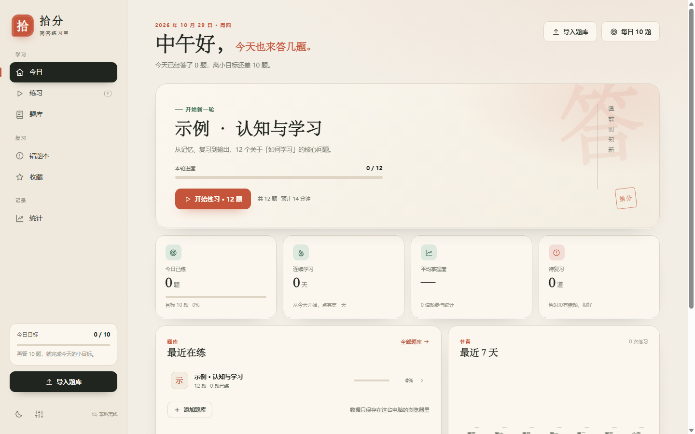
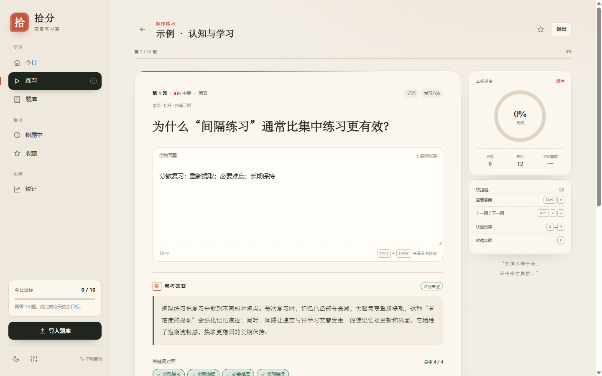
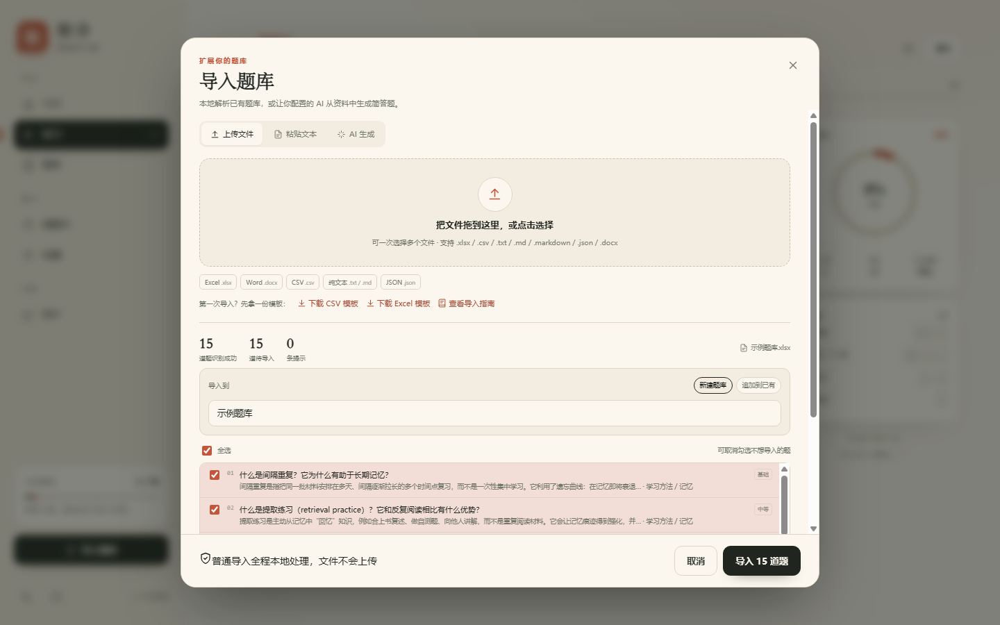
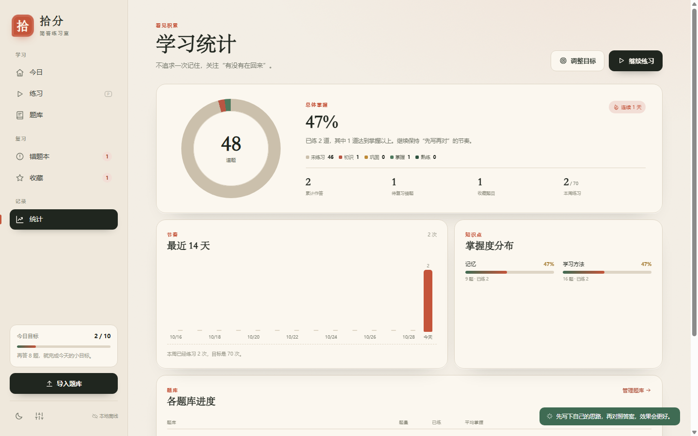
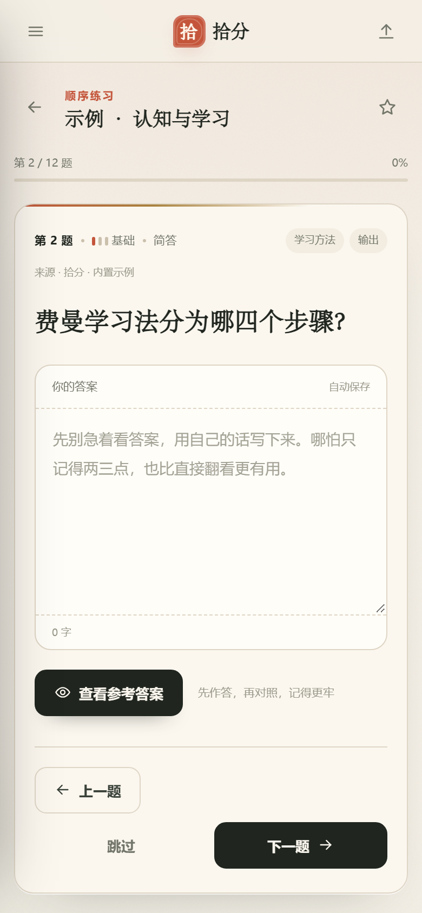
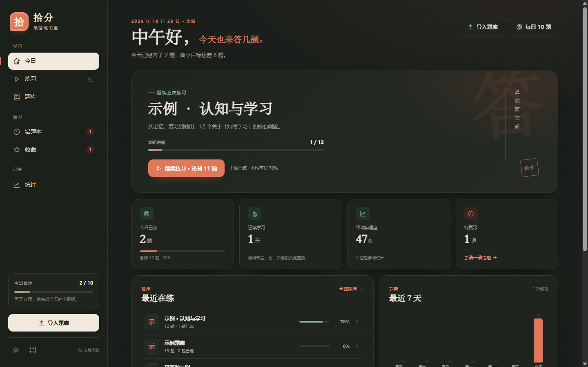

# 拾分 · E2E 验收报告

- 生成时间：2026/10/29 12:33:57
- 运行模式：full
- 运行耗时：22 秒
- 静态服务：http://127.0.0.1:8765/ （复用已有服务）
- 浏览器：Chrome/154.0.8037.98（shared-cdp，CDP 9334）
- 视口：桌面 1440x900；移动端 390x844

## 应用文件

- index.html: 19043 bytes
- js/app.js: 176021 bytes
- js/importers.js: 63870 bytes
- css/styles.css: 88248 bytes
- samples: 示例题库.csv, 示例题库.xlsx, 简答题示例.docx

## 结果汇总

| 通过 | 失败 | 跳过 | 合计 |
| --- | --- | --- | --- |
| 14 | 0 | 0 | 14 |

**结论：14/14 项通过，0 项失败，验收通过。**

## 逐项结果

| 编号 | 验收项 | 结果 | 证据摘要 | 截图 |
| --- | --- | --- | --- | --- |
| T0 | 应用启动与首屏 | PASS | 页面标题：今日 · 拾分；首屏文本：跳到主要内容 拾 拾分 简答练习室 学习 今日 练习 P 题库 复习 错题本 收藏 记录 统计 今日目标 0 / 10 再答 10 题，就完成今天的小目标。 导入题库 本地离线 2026 年 10 月 29 日 · 周四 中午好，今天也来答几题。 今天已经答了 0 题，离小目标还差 10 题。 导入题库 每日 10 题… | [图](screenshots/01-dashboard-1440.png) |
| T1 | DOM 结构契约 | PASS | 静态契约节点 29 个全部存在；动态导入弹窗节点 5 个全部存在；契约偏差：#importModal 未实现；导入弹窗实际为 #modalRoot 内动态 .modal-overlay，功能节点齐全 | — |
| T2 | 首次打开载入内置示例题库 | PASS | 内置题库：1 个；题目：12 题；仪表盘文本：跳到主要内容 拾 拾分 简答练习室 学习 今日 练习 P 题库 复习 错题本 收藏 记录 统计 今日目标 0 / 10 再答 10 题，就完成今天的小目标。 导入题库 本地离线 2026 年 10 月 29 日 · 周四 中午好，今天也来答几题。 今天已经答了 0 题，离小目标还差 10 题。 导入题库 每日 1… | — |
| T3 | 练习主流程 | PASS | 第一题：为什么“间隔练习”通常比集中练习更有效？（id=sample_1）；参考答案：间隔练习把复习分散到不同的时间点。每次复习时，记忆已经部分衰减，大脑需要重新提取，这种“有难度的提取”会强化记忆痕迹；同时，间隔让遗忘与再学习交替发生，促使记忆被更新和巩固。它牺牲了短期流畅感，换取更稳固的长期保持。；关键词 chip：4 个（分散复习 重新提取 必要难度 … | [图](screenshots/02-practice-1440.png) |
| T4 | 导入 XLSX 并进入练习 | PASS | 导入预览（示例题库.xlsx）: 15 道题识别成功 15 道待导入 0 条提示 示例题库.xlsx 导入到 新建题库 追加到已有 全选 可取消勾选不想导入的题 01 什么是间隔重复？它为什么有助于长期记忆？ 间隔重复是指把同一批材料安排在多天、间隔逐渐拉长的多个时间点复习，而不是一次性集中学习。它利用了遗忘曲线：在记忆即将衰退… · 学习方法 / 记忆 基… | [图](screenshots/03-import-preview.png) [图](screenshots/07-banks-1440.png) |
| T5 | 导入 DOCX | PASS | 导入预览（简答题示例.docx）: 6 道题识别成功 6 道待导入 0 条提示 简答题示例.docx 导入到 新建题库 追加到已有 全选 可取消勾选不想导入的题 01 什么是间隔重复？它为什么有助于长期记忆？ 间隔重复是指把同一批材料安排在多天、间隔逐渐拉长的多个时间点复习，而不是一次性集中学习。它利用了遗忘曲线：在记忆即将衰退… · 学习方法 / 记忆 基… | [图](screenshots/03b-import-docx-preview.png) |
| T6 | 导入 CSV | PASS | 导入预览（示例题库.csv）: 15 道题识别成功 15 道待导入 0 条提示 示例题库.csv 导入到 新建题库 追加到已有 全选 可取消勾选不想导入的题 01 什么是间隔重复？它为什么有助于长期记忆？ 间隔重复是指把同一批材料安排在多天、间隔逐渐拉长的多个时间点复习，而不是一次性集中学习。它利用了遗忘曲线：在记忆即将衰退… · 学习方法 / 记忆 基础 … | [图](screenshots/03c-import-csv-preview.png) |
| T7 | 刷新持久化 | PASS | 已收藏当前题；笔记已写入：QA 笔记 1793248425275；刷新后题库 4 个、题目 48 题、进度与收藏/笔记均保留；刷新后题库视图完整 | — |
| T8 | 错题本与错题重练 | PASS | 错题：什么是间隔重复？它为什么有助于长期记忆？（attempts=1, lastRating=0）；错题本已收录该题；“错题重练”回到原题 | [图](screenshots/08-wrongbook-1440.png) |
| T9 | 统计视图 | PASS | 统计文本：看见积累 学习统计 不追求一次记住，关注“有没有在回来”。 调整目标 继续练习 48 道题 总体掌握 47% 连续 1 天 已练 2 道，其中 1 道达到掌握以上。继续保持“先写再对”的节奏。 未练习 46 初识 1 巩固 0 掌握 1 熟练 0 2 累计作答 1 待复习错题 1 收藏题目 2 / 70 本周练习 节奏 最近 14 天 2 次 10… | [图](screenshots/04-stats-1440.png) |
| T10 | 移动端 390px | PASS | 视口：innerWidth=390, visualViewport=390, dpr=2；scrollWidth: doc=390, body=390, client=390；疑似越界元素：aside#sidebar.sidebar[-294,-14] button#sidebarClose.sidebar-close[-63,-29] svg[-55,-3… | [图](screenshots/05-mobile-390.png) [图](screenshots/05b-mobile-sidebar.png) |
| T11 | 深色主题 | PASS | 主题操作：click:深色；深色主题已生效且写入 settings.theme；深色背景：{"bg":"rgb(23, 27, 23)","avg":24.333333333333332}；刷新后深色主题保持 | [图](screenshots/06-dark-1440.png) |
| T12 | 数据导出 JSON | PASS | 导出文件：拾分备份-2026-10-29.json；导出 JSON 有效：4 题库 / 48 题 / version=1；导出→导入 JSON 往返字段一致（banks/questions/progress/settings 未丢失） | — |
| T13 | 控制台健康 | PASS | 控制台干净 | — |

## 用例明细

### T0 应用启动与首屏 — PASS

- 验收标准：打开 index.html 后 #app 渲染、标题正确、首屏无脚本错误
- 步骤：
  1. 启动静态服务
  2. Chrome headless 打开 http://127.0.0.1:8765/index.html
  3. 等待 #app 渲染并截图
- 证据：
  - 页面标题：今日 · 拾分
  - 首屏文本：跳到主要内容 拾 拾分 简答练习室 学习 今日 练习 P 题库 复习 错题本 收藏 记录 统计 今日目标 0 / 10 再答 10 题，就完成今天的小目标。 导入题库 本地离线 2026 年 10 月 29 日 · 周四 中午好，今天也来答几题。 今天已经答了 0 题，离小目标还差 10 题。 导入题库 每日 10 题…
- 截图：[screenshots/01-dashboard-1440.png](screenshots/01-dashboard-1440.png)
- 耗时：930 ms

### T1 DOM 结构契约 — PASS

- 验收标准：契约第 4 节列出的容器/视图/练习节点/弹窗节点全部存在
- 步骤：
  1. 读取文档中全部契约选择器
  2. 在页面内逐个查询并列出缺失项
- 证据：
  - 静态契约节点 29 个全部存在
  - 动态导入弹窗节点 5 个全部存在
  - 契约偏差：#importModal 未实现；导入弹窗实际为 #modalRoot 内动态 .modal-overlay，功能节点齐全
- 耗时：328 ms

### T2 首次打开载入内置示例题库 — PASS

- 验收标准：首次打开自动载入内置示例题库（≥10 题），仪表盘可见“继续练习”
- 步骤：
  1. 清空态启动（独立 profile 已保证）
  2. 读取 localStorage shifen.v1
  3. 切到仪表盘检查文案
- 证据：
  - 内置题库：1 个；题目：12 题
  - 仪表盘文本：跳到主要内容 拾 拾分 简答练习室 学习 今日 练习 P 题库 复习 错题本 收藏 记录 统计 今日目标 0 / 10 再答 10 题，就完成今天的小目标。 导入题库 本地离线 2026 年 10 月 29 日 · 周四 中午好，今天也来答几题。 今天已经答了 0 题，离小目标还差 10 题。 导入题库 每日 10 题 开始新一轮 示例 · 认知与学习 从记忆、复习到输出，12 个关于「如何学习」…
- 耗时：269 ms

### T3 练习主流程 — PASS

- 验收标准：显示第一题 → 输入答案 → 查看参考答案（答案/关键词/解析）→ 点评级（掌握度更新）→ 下一题
- 步骤：
  1. 进入练习视图，确认第一题显示
  2. 在 #answerInput 输入包含关键词的答案
  3. 点击 #revealBtn，检查 #referencePanel/#referenceText/#keywordChips/解析
  4. 点击评级“掌握”，检查 localStorage progress.mastery/lastRating
  5. 点击 #nextBtn（或自动）确认进入下一题
- 证据：
  - 第一题：为什么“间隔练习”通常比集中练习更有效？（id=sample_1）
  - 参考答案：间隔练习把复习分散到不同的时间点。每次复习时，记忆已经部分衰减，大脑需要重新提取，这种“有难度的提取”会强化记忆痕迹；同时，间隔让遗忘与再学习交替发生，促使记忆被更新和巩固。它牺牲了短期流畅感，换取更稳固的长期保持。
  - 关键词 chip：4 个（分散复习 重新提取 必要难度 长期保持）
  - 解析已显示
  - 练习进度：第 1 / 12 题
  - 评级后 attempts=1 lastRating=2 mastery=78
  - 掌握度锚点符合最新 master [15,45,78,100]
  - 备注：契约 §2 的加权公式为旧版，实现已改为 master 锚点（Lead 已确认）
  - 已按设置自动进入下一题
  - #progressFill 宽度：85px
- 截图：[screenshots/02-practice-1440.png](screenshots/02-practice-1440.png)
- 耗时：2114 ms

### T4 导入 XLSX 并进入练习 — PASS

- 验收标准：选择 samples/示例题库.xlsx 后预览显示题数，确认后题库出现且题目可进入练习
- 步骤：
  1. 点击 #importBtn 打开导入弹窗
  2. 通过 CDP 设置 #fileInput 为 samples/示例题库.xlsx
  3. 等待 #importPreview 显示解析结果并截图
  4. 点击 #confirmImport，检查新增题库/题目
  5. 进入题库视图，从新题库开始练习，校验当前题目属于新题库
- 证据：
  - 导入预览（示例题库.xlsx）: 15 道题识别成功 15 道待导入 0 条提示 示例题库.xlsx 导入到 新建题库 追加到已有 全选 可取消勾选不想导入的题 01 什么是间隔重复？它为什么有助于长期记忆？ 间隔重复是指把同一批材料安排在多天、间隔逐渐拉长的多个时间点复习，而不是一次性集中学习。它利用了遗忘曲线：在记忆即将衰退… · 学习方法 / 记忆 基础 02 什么是提取练习（retrieval practice）？它和反复阅读相比有什么优势？ 提取练习是主动从记忆中“回忆”知识，例如合上书复述、做自测题、向他人讲解，而不是重复阅读材料。它会让记忆痕迹得到强化，并… · 学习方法 / 记忆 中等 03 什么是认知负荷？如何降低外在认知负荷？ 认知负荷是工作记忆在完成任务时承受的心理负担，分为内在负荷（任务本身难度）、外在负荷（信息呈现方式不当造成）和相关负荷（… · 认知科学 / 学习设计 中等 04 费曼学习法的核…
  - 确认按钮：导入 15 道题
  - 新增题目：15 题；新增题库：1 个
  - 题库视图已显示：示例题库
  - 已从导入题库进入练习
- 截图：[screenshots/03-import-preview.png](screenshots/03-import-preview.png)、[screenshots/07-banks-1440.png](screenshots/07-banks-1440.png)
- 耗时：2540 ms

### T5 导入 DOCX — PASS

- 验收标准：上传 samples/简答题示例.docx 成功导入并生成题目
- 步骤：
  1. 打开导入弹窗
  2. 选择 docx 文件
  3. 检查预览并确认
  4. 校验新增题目字段
- 证据：
  - 导入预览（简答题示例.docx）: 6 道题识别成功 6 道待导入 0 条提示 简答题示例.docx 导入到 新建题库 追加到已有 全选 可取消勾选不想导入的题 01 什么是间隔重复？它为什么有助于长期记忆？ 间隔重复是指把同一批材料安排在多天、间隔逐渐拉长的多个时间点复习，而不是一次性集中学习。它利用了遗忘曲线：在记忆即将衰退… · 学习方法 / 记忆 基础 02 什么是认知负荷？如何降低外在认知负荷？ 认知负荷是工作记忆在完成任务时承受的心理负担，分为内在负荷（任务本身难度）、外在负荷（信息呈现方式不当造成）和相关负荷（… · 认知科学 / 学习设计 中等 03 TCP 三次握手的作用是什么？请描述其过程。 三次握手用于在不可靠的网络上建立可靠连接：确认双方的发送与接收能力、同步初始序列号，并避免历史重复连接请求造成资源浪费。… · 计算机网络 / 协议 挑战 04 哈希表的基本原理是什么？平均时间复杂度如何？冲突有哪些…
  - 确认按钮：导入 6 道题
  - DOCX 新增题目 6 题
  - 示例：什么是间隔重复？它为什么有助于长期记忆？ / 答案 间隔重复是指把同一批材料安排在多天、间隔逐渐拉长的多个时间点复习，而不是一次性集…
- 截图：[screenshots/03b-import-docx-preview.png](screenshots/03b-import-docx-preview.png)
- 耗时：1090 ms

### T6 导入 CSV — PASS

- 验收标准：上传 samples/示例题库.csv 成功导入并生成题目
- 步骤：
  1. 打开导入弹窗
  2. 选择 csv 文件
  3. 检查预览并确认
  4. 校验新增题目字段
- 证据：
  - 导入预览（示例题库.csv）: 15 道题识别成功 15 道待导入 0 条提示 示例题库.csv 导入到 新建题库 追加到已有 全选 可取消勾选不想导入的题 01 什么是间隔重复？它为什么有助于长期记忆？ 间隔重复是指把同一批材料安排在多天、间隔逐渐拉长的多个时间点复习，而不是一次性集中学习。它利用了遗忘曲线：在记忆即将衰退… · 学习方法 / 记忆 基础 02 什么是提取练习（retrieval practice）？它和反复阅读相比有什么优势？ 提取练习是主动从记忆中“回忆”知识，例如合上书复述、做自测题、向他人讲解，而不是重复阅读材料。它会让记忆痕迹得到强化，并… · 学习方法 / 记忆 中等 03 什么是认知负荷？如何降低外在认知负荷？ 认知负荷是工作记忆在完成任务时承受的心理负担，分为内在负荷（任务本身难度）、外在负荷（信息呈现方式不当造成）和相关负荷（… · 认知科学 / 学习设计 中等 04 费曼学习法的核心…
  - 确认按钮：导入 15 道题
  - CSV 新增题目 15 题
- 截图：[screenshots/03c-import-csv-preview.png](screenshots/03c-import-csv-preview.png)
- 耗时：917 ms

### T7 刷新持久化 — PASS

- 验收标准：刷新后导入的题库、练习进度、收藏、笔记均保留
- 步骤：
  1. 在练习页收藏当前题并写入笔记
  2. 快照 localStorage 的 banks/questions/progress/settings
  3. Page.reload 刷新页面
  4. 对比刷新前后快照并检查题库视图
- 证据：
  - 已收藏当前题
  - 笔记已写入：QA 笔记 1793248425275
  - 刷新后题库 4 个、题目 48 题、进度与收藏/笔记均保留
  - 刷新后题库视图完整
- 耗时：2840 ms

### T8 错题本与错题重练 — PASS

- 验收标准：评级“忘记”后题目进入错题本，可“错题重练”
- 步骤：
  1. 练习中查看参考答案并评级“忘记”
  2. 检查 progress 判定（attempts>0 && lastRating<=1）
  3. 进入错题本视图，确认该题出现
  4. 点击“错题重练”，确认回到练习且题目一致
- 证据：
  - 错题：什么是间隔重复？它为什么有助于长期记忆？（attempts=1, lastRating=0）
  - 错题本已收录该题
  - “错题重练”回到原题
- 截图：[screenshots/08-wrongbook-1440.png](screenshots/08-wrongbook-1440.png)
- 耗时：1417 ms

### T9 统计视图 — PASS

- 验收标准：题量、已练、掌握度、7 日活跃图正常渲染
- 步骤：
  1. 进入统计视图
  2. 核对题量/已练数字与 state 一致
  3. 确认掌握度与图表元素渲染
  4. 截图
- 证据：
  - 统计文本：看见积累 学习统计 不追求一次记住，关注“有没有在回来”。 调整目标 继续练习 48 道题 总体掌握 47% 连续 1 天 已练 2 道，其中 1 道达到掌握以上。继续保持“先写再对”的节奏。 未练习 46 初识 1 巩固 0 掌握 1 熟练 0 2 累计作答 1 待复习错题 1 收藏题目 2 / 70 本周练习 节奏 最近 14 天 2 次 10/16 10/18 10/20 10/22 10/24 10/26 10/28 2 今天 …
  - 活跃图标题：最近十四天练习次数；柱数：14
  - 契约说明：验收要求“7 日活跃图”，实现为最近 14 天（含本周 7 日汇总），数据完整
- 截图：[screenshots/04-stats-1440.png](screenshots/04-stats-1440.png)
- 耗时：967 ms

### T10 移动端 390px — PASS

- 验收标准：390px 宽无横向滚动，侧栏可开合
- 步骤：
  1. Emulation.setDeviceMetricsOverride 390x844 mobile
  2. 检查 window.innerWidth≈390 且 scrollWidth<=clientWidth
  3. 截图
  4. 找到菜单/侧栏按钮，开合并截图
- 证据：
  - 视口：innerWidth=390, visualViewport=390, dpr=2
  - scrollWidth: doc=390, body=390, client=390
  - 疑似越界元素：aside#sidebar.sidebar[-294,-14] button#sidebarClose.sidebar-close[-63,-29] svg[-55,-37] use[-50,-41] a.brand[-274,-35] span.brand-mark[-270,-224] span.brand-wor…
  - 初始侧栏：{"open":false,"left":-294,"right":-14,"width":280,"transform":"matrix(1, 0, 0, 1, -294, 0)"}
  - 点击后侧栏：{"open":true,"left":0,"right":280,"width":280,"transform":"none"}
- 截图：[screenshots/05-mobile-390.png](screenshots/05-mobile-390.png)、[screenshots/05b-mobile-sidebar.png](screenshots/05b-mobile-sidebar.png)
- 耗时：3667 ms

### T11 深色主题 — PASS

- 验收标准：设置中切换深色主题后立即生效，且刷新后保持
- 步骤：
  1. 点击 #settingsBtn 打开设置
  2. 选择“深色”主题
  3. 检查 data-theme/背景色变暗且 settings.theme=dark
  4. 刷新后验证保持
- 证据：
  - 主题操作：click:深色
  - 深色主题已生效且写入 settings.theme
  - 深色背景：{"bg":"rgb(23, 27, 23)","avg":24.333333333333332}
  - 刷新后深色主题保持
- 截图：[screenshots/06-dark-1440.png](screenshots/06-dark-1440.png)
- 耗时：2568 ms

### T12 数据导出 JSON — PASS

- 验收标准：设置中提供数据导出时，导出的 JSON 包含完整 banks/questions/settings，字段不丢
- 步骤：
  1. 打开设置弹窗
  2. 查找“导出/下载数据”入口
  3. 触发下载并读取 JSON
  4. 与 localStorage 对比题量/题库/字段
- 证据：
  - 导出文件：拾分备份-2026-10-29.json
  - 导出 JSON 有效：4 题库 / 48 题 / version=1
  - 导出→导入 JSON 往返字段一致（banks/questions/progress/settings 未丢失）
- 耗时：1699 ms

### T13 控制台健康 — PASS

- 验收标准：整个流程无未捕获异常、无错误级控制台输出
- 步骤：
  1. 汇总 Runtime.exceptionThrown 与 Runtime.consoleAPICalled(error)/Log(error)
  2. 过滤 favicon 等无关资源噪声
- 证据：
  - 控制台干净
- 耗时：0 ms

## 控制台报错

- 未捕获异常：0 条
- 错误级控制台输出：0 条
- 警告：0 条

## 状态摘要

- 题库：4 个（示例 · 认知与学习、示例题库、简答题示例、示例题库）
- 题目：48 题；已练习：2 题；收藏：1 题
- 设置：{"dailyGoal":10,"theme":"dark","autoNext":true,"shuffle":false,"ai":{"enabled":false,"provider":"deepseek","baseUrl":"https://api.deepseek.com/v1","model":"deepseek-chat","apiKey":"","temperature":0.3,"autoKeywords":false}}
- localStorage shifen.v1：21195 chars

## 展示截图

### 01-dashboard-1440

### 02-practice-1440

### 03-import-preview

### 04-stats-1440

### 05-mobile-390

### 06-dark-1440

全部截图：

- [00-infra-preflight.png](screenshots/00-infra-preflight.png)
- [01-dashboard-1440.png](screenshots/01-dashboard-1440.png)
- [02-practice-1440.png](screenshots/02-practice-1440.png)
- [03-import-preview.png](screenshots/03-import-preview.png)
- [03b-import-docx-preview.png](screenshots/03b-import-docx-preview.png)
- [03c-import-csv-preview.png](screenshots/03c-import-csv-preview.png)
- [04-stats-1440.png](screenshots/04-stats-1440.png)
- [05-mobile-390.png](screenshots/05-mobile-390.png)
- [05b-mobile-sidebar.png](screenshots/05b-mobile-sidebar.png)
- [06-dark-1440.png](screenshots/06-dark-1440.png)
- [07-banks-1440.png](screenshots/07-banks-1440.png)
- [08-wrongbook-1440.png](screenshots/08-wrongbook-1440.png)

## 测试基础设施自检

- Runtime.evaluate：1+1=2
- 点击：按钮后 #out=1
- 文件上传：preflight-upload.txt
- 截图：screenshots/00-infra-preflight.png

## 契约偏差与说明（不阻塞本轮验收）

- **#importModal**：导入弹窗由 `#modalRoot` 内动态 `.modal-overlay` 渲染，没有契约 §4 的 `#importModal` id；内部 `#dropZone/#fileInput/#pasteInput/#importPreview/#confirmImport` 全部存在，功能验收通过。
- **首屏文案**：首次打开仪表盘显示「开始练习 · 12 题」，契约 §5.1 写的是「继续练习」；进入练习与续练能力一致。
- **活跃图周期**：统计页渲染「最近 14 天」柱状图（含本周 7 日汇总），契约 §5.6 写「7 日活跃图」；数据与柱数完整。
- **掌握度**：实现采用 master 锚点 `[15,45,78,100]`（首次「掌握」=78），与契约 §2 旧版加权公式不同；已按 Lead 确认的定稿口径验证。

## 备注

- 测试使用独立临时 Chrome user-data-dir，每次运行 localStorage 均为空，可重复执行。
- 测试只读取产品文件，不修改产品代码；发现的问题以本报告 + 截图 + 控制台错误为准。
- 上传文件均来自 samples/，未联网、未安装任何 npm 包。
